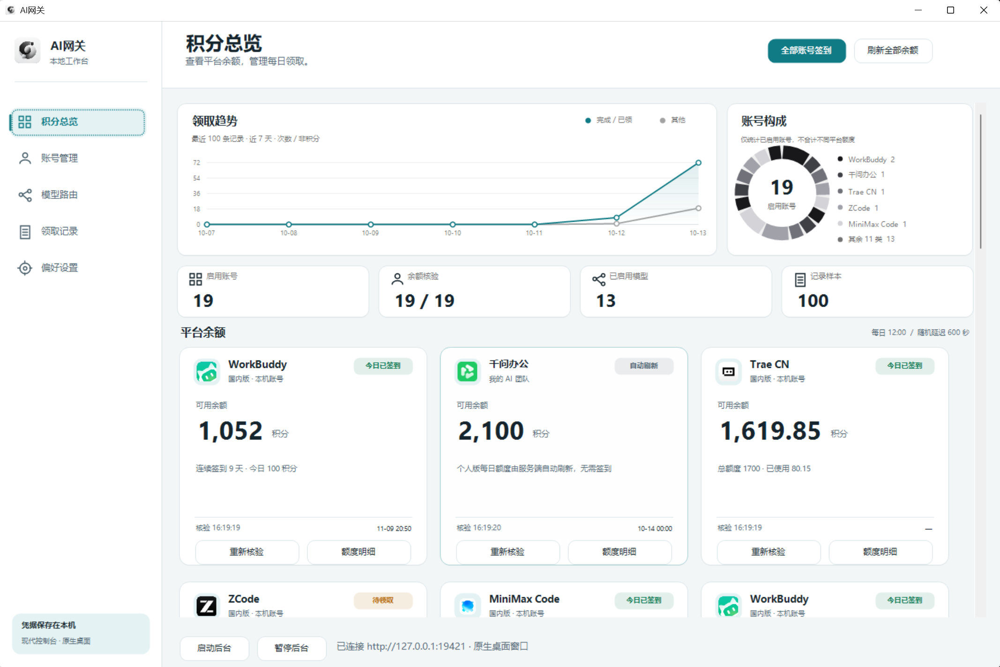

<h1 align="center">AI网关</h1>

<p align="center">
  <b>把多平台桌面账号的每日权益、余额与模型调用，收拢成一个本机 OpenAI 兼容网关</b><br>
  多账号签到 · 积分耗尽切号 · 模型目录与真实体检 · SSE · 工具调用 · DSH · Hermes · 任意 OpenAI 兼容客户端
</p>

<p align="center">
  <a href="package.json"></a>
  <a href="LICENSE"></a>
  
  
</p>

AI网关（AI gateway）是一个**本机运行的独立服务**：一边读取本机已登录桌面客户端的登录态，完成每日签到与免费额度领取；一边把这些平台的原生协议映射成 OpenAI 兼容接口，让 DSH、Hermes、FleshOut 等调用端经同一入口使用模型。

> **分发形式：本公开仓库只包含后端、CLI、平台适配器、DSH 插件、测试与文档。原生桌面前端实现与安装包不公开。** 克隆仓库得到的是可运行的无界面服务，可按管理 API 自建前端。
>
> **兼容 ID：** npm 包 `dsh-ai-credit-gateway`、CLI `ai-credit`、Provider `ai-credit` 沿用历史命名，不随产品更名改变；仓库路径保留 `https://github.com/spdw666/multi-agent-checkin-dsh`。



*用户提供的本机界面原图（文档资产；仓库不含该前端实现）。图中账号数、已启用模型、签到时间与余额为截图时的个人配置，不是新部署默认值或额度承诺。*

## 产品定位

两件事：

1. **每日权益与余额**：读取本机客户端登录态，按账号签到、检查每日免费额度或领取免费套餐，结果写入 SQLite 幂等账本；余额按账号分别核验。
2. **统一模型入口**：把各上游协议映射为 OpenAI 兼容接口，调用端只认一条 `/v1`；工具由**调用端**执行，网关只做协议映射。

- **不是第三方 API 中转站**：只对接本项目实现的上游类型；Antigravity 走本机专用协议桥，只接受 `127.0.0.1`，不恢复任意中转站 URL 或 relay 配置。
- **不做跨平台统一积分**：积分、Token、现金与资源包单位不同，分项展示，**不相加成总余额**。
- **不做凭据托管**：平台 token / Cookie 只留在本机账号文件里，配置只存引用，不进仓库、日志或聊天。
- **不把未验收当已完成**：图片输入与跨平台统一余额未验收；缺失数据显示为未知，不用 `0` 或绿色填充。

## 关键功能

| 能力 | 实现 |
|---|---|
| 每日权益 | 多平台签到、免费套餐领取、每日额度核验；启动检查 + 每日排程 + 随机延迟 + 失败重试 |
| 多账号隔离 | 每账号独立本机凭据与稳定身份绑定；幂等账本按身份 + 任务 + 日期（或活动窗口）去重并保留回执 |
| 账号池 | 同模型可配备用账号，积分耗尽且尚未输出内容时切号；管理 API 可指定下一请求账号，不轮询、不迁移正在输出的请求 |
| 模型目录与体检 | 目录发现、真实请求体检、导入发布三者分离；全量 / 已导入 / 定向复测 / 勾选选测四种范围 |
| OpenAI 兼容 | `GET /v1/models`、`POST /v1/chat/completions`，普通与 SSE 共用映射层，按 `targets` 顺序回退 |
| 工具调用 | 结构化 `tool_calls` 与结果回传；已输出 SSE 后不重放整段请求，避免重复工具动作 |
| 余额与用量 | 区分真实零 / 未知 / 带核验时间的缓存值；按实际上游尝试记账，回退尝试共享 `requestId` |
| 接入方式 | DSH bundle、Hermes 命名 Provider、任意 OpenAI 兼容客户端；模型 API 与管理 API 分离 |

支持的桌面平台（证据强度以本机实测与各平台官方文档为准）：WorkBuddy、Trae（CN / 国际）、千问办公、MiniMax Code、ZCode、智谱 BigModel、Antigravity、NVIDIA NIM、Qoder、CodeBuddy、CodeArts Agent、LobsterAI、Cline、商汤小浣熊、Loomy。逐平台登录态来源与注意事项见 [docs/desktop-platforms.md](docs/desktop-platforms.md)。

### 与原生前端本地分发的区别

| 维度 | 原生桌面前端（不随包分发） | 公开源码包（本仓库） |
|---|---|---|
| 交付物 | 独立界面：签到、余额、模型、体检、用量页 | headless 服务 + CLI + 管理 API |
| 使用方式 | 图形界面操作 | `node bin/ai-credit.mjs ...` 或自建前端调管理 API |

两者共用同一配置、账本与数据目录，**源码包不是"阉割的界面"，而是同一后端服务的无界面形态**：界面上能看到的内容都能通过 CLI 与管理 API 获取；`ai-credit ui` 在源码包里只返回明确提示，不安装也不打开界面。

## 快速开始（Node.js 24+）

```powershell
git clone https://github.com/spdw666/multi-agent-checkin-dsh.git
cd multi-agent-checkin-dsh
npm ci
npm run build                      # 用 esbuild 打包 vendor 适配层
powershell -NoProfile -ExecutionPolicy Bypass -File scripts/install.ps1 -NoStart
notepad config.local.json          # 先启用本机已登录的平台
node bin/ai-credit.mjs doctor      # 本机凭据形状与身份
node bin/ai-credit.mjs start       # 后台启动，日志在数据目录 service.log
Invoke-RestMethod http://127.0.0.1:19421/health
```

```bash
# Linux / macOS
npm ci && npm run build && bash scripts/install.sh --no-start
node bin/ai-credit.mjs doctor && node bin/ai-credit.mjs start && curl http://127.0.0.1:19421/health
```

- 需要 **Node.js 24+**（内置 SQLite）与 npm（构建依赖 esbuild）；`npm run check` = 构建 + 完整离线回归。
- 常用命令：`init` / `serve`（前台，便于看启动错误）/ `start` / `stop` / `doctor` / `health` / `claim` / `models` / `records`；用 `--config <绝对路径>` 或 `AI_CREDIT_CONFIG` 指定别的配置。Windows 可直接写 `C:\...` 路径；数据目录默认 `./data`，相对配置文件所在目录解析。

## 配置与凭据

配置分三层，模板见 [config.example.json](config.example.json)：`accounts`（账号与登录态来源）→ `upstreams`（上游适配器）→ `routes`（对外路由 ID 与目标模型）。

```json
{
  "accounts": [{"id": "workbuddy-main", "platform": "workbuddy", "enabled": true,
    "credentials": {"kind": "desktop", "file": "auto"}, "tasks": [{"id": "daily-checkin", "enabled": true}]}],
  "upstreams": [{"id": "workbuddy", "kind": "workbuddy", "accountId": "workbuddy-main", "enabled": true}],
  "routes": [{"id": "workbuddy/deepseek-v4.1-flash", "enabled": true,
    "targets": [{"upstreamId": "workbuddy", "model": "deepseek-v4.1-flash"}]}]
}
```

此段只说明三层关系，**不是可独立使用的完整文件**；模型 ID 需换成当前目录里的真实值。

- **凭据本机录入，绝不写进配置**：配置解析会拒绝任何内联密钥字段（`apiKey` / `token` / `cookie` / `secret` 等），只接受指向本机账号文件的引用；平台登录请在官方客户端里正常完成。
- **网关自己的两把密钥**：初始化生成 `data/api-keys.json`，`apiKey` 用于模型调用、`adminKey` 用于管理操作，两者不可互相替代，内容不要贴到聊天或工单里。
- **示例默认只启用一条 WorkBuddy 路由**，其余账号多为停用，别照界面截图推断平台已配置好；`enabled: false` 表示保留配置但停用，停用路由从 `/v1/models` 隐藏。登录态过期、换账号或设备身份变化时先用 `doctor` 核对，明确要重绑再调 `POST /admin/rebind`。

## 界面功能对应的命令与接口

| 页面 | 用途 | CLI / 管理 API |
|---|---|---|
| 签到 | 逐账号签到与领取结果 | `ai-credit claim --all` · `POST /admin/claim` · `GET /admin/records` |
| 余额 | 各平台余额、分项与核验时间 | `GET /admin/balances`（`?refresh=1` 强刷） |
| 模型目录 | 发现各上游当前可用模型 | `GET /admin/model-directory`、`POST /admin/catalog`、`POST /admin/model-import` |
| 选测体检 | 勾选模型做真实请求验证 | `POST /admin/model-tests`（`scope: selected`）+ 轮询 `GET /admin/model-tests` |
| 用量 | 请求明细、Token、计费与余额变化 | `GET /admin/usage` |

**签到看逐账号结果，不看 HTTP 状态码**：`200` 不等于权益已发放；`already` 是此前已签到或已领取，不是又发一次。千问办公个人版的每日额度由服务端**自动重置**，本项目只做观察（`observed`）——**"官方每日自动额度"不等于"主动签到成功"**。批量命令的退出码也不能替代逐项检查。

**余额三态必须区分**：数值（含真实 `0`）、`value: null`（未知）、带 `checkedAt` 的缓存值（`stale: true`，本次核验失败的旧结果）。界面与自建前端都不要给未知状态"假绿"。

**Token 预算按模型上限设置**：客户端默认输出上限常高于个别上游允许值，会被明确拒绝（例如 `nvidia_max_tokens_invalid`），网关不做静默截断，按每条路由的实际上限配置即可。**NVIDIA 的公示上限不等于实时剩余额度**：官方策略（`source: official_policy`）只说明配额制度，反映当前窗口的是官方响应头观测（`source: official_response_headers`），本机统计只是本机调用量；`dailyLimit` 与 `remaining` 恒为 `null`（官方已取消积分制），凭据缺失或验证失败时清空历史额度而不伪造数字。详见 [docs/nvidia-source-notes.md](docs/nvidia-source-notes.md) 与 [docs/openai-clients.md](docs/openai-clients.md)。

## 接入 DSH

本项目同时是 DSH bundle，peers 范围为 `>=0.1.7-rc.1 <0.3.0-0`，接入基于具体 DSH Desktop / runtime 版本与 `desktop` profile。

```powershell
$env:AI_CREDIT_NODE = (Get-Command node).Source
node scripts/install-dsh.mjs --config /ABSOLUTE/PATH/config.local.json
```

安装脚本定位 Desktop CLI、备份 profile、添加 bundle 并同步代码，记录写在数据目录的 `dsh-install/`；**不自动重启 DSH**。worker 使用独立 Node 24，不把 Electron / 桌面可执行文件当 Node。流程、插件配置与其他安装方式见 [docs/dsh.md](docs/dsh.md)，首包等待与输出预算见 [docs/dsh-request-policy.md](docs/dsh-request-policy.md)。

## 接入 Hermes

Hermes 用命名自定义 Provider 直连本机网关，不需要 DSH 插件：

```yaml
providers:
  ai-credit:
    name: AI网关
    base_url: http://127.0.0.1:19421/v1
    api_mode: chat_completions
    discover_models: true
    key_cmd: '"/ABSOLUTE/PATH/node" "/ABSOLUTE/PATH/scripts/hermes-key.mjs" "/ABSOLUTE/PATH/data/api-keys.json"'
    extra_body:
      reasoning_effort: null
```

- `key_cmd` 每次只读 `apiKey`，经标准输出交付，不写入 YAML、`.env` 或日志；缺文件、非法 JSON 或空密钥只输出固定错误并返回非零退出码。
- `reasoning_effort: null` 把统一档位交还给网关与上游的默认策略；`discover_models: true` 从 `/v1/models` 获取启用路由，不写死清单，也不恢复已停用项。

完整 YAML、分层验证与回滚见 [docs/hermes.md](docs/hermes.md)。网关需保持运行，工具执行仍由 Hermes 完成。

## 接入 FleshOut 与其他 OpenAI 兼容客户端

网关对外只有一条 OpenAI 兼容入口，**任何支持自定义 OpenAI 端点的客户端都能接入，本仓库不需要为它写适配器**：

```text
第三方客户端 → http://127.0.0.1:19421/v1 → 已启用的平台路由
```

| 字段 | 取值 |
|---|---|
| Base URL | `http://127.0.0.1:19421/v1`（含 `/v1`） |
| API Key | `data/api-keys.json` 的 `apiKey`（`adminKey` 只管管理 API） |
| Model | `GET /v1/models` 返回的路由 ID，原样使用，**包含斜杠** |

- 方向只有一个：**客户端填本网关地址**。网关不反向代理、不抓取、不注入任何客户端进程，不需要改客户端的可执行文件或前端资源；模型 ID 形如 `上游ID/模型名`，若客户端会对它做路径或 URL 编码处理，先确认能原样传输。
- FleshOut（Tauri 桌面写作软件）是本机实测案例：模型存在它自己的 SQLite 里，新建 `Custom` 连接填上面三要素即可；字段与输出上限见 [docs/openai-clients.md](docs/openai-clients.md)，带整库备份、冲突检测和默认预览的目录同步工具见 [docs/fleshout-sync.md](docs/fleshout-sync.md)。
- 客户端界面缺少自定义选项时，也可把同样的行写入客户端自己的模型存储，但必须先关闭该客户端（或确认数据库为 WAL 且允许并发写）、先备份整库并记录校验值、只新增行与改默认模型字段、写完重启确认。
- 网关需保持运行，客户端不会自动拉起它。统一验证顺序：`/v1/models` → 客户端"测试连接" → 普通短请求 → 真实任务（长文 / 多轮 / 客户端自身流式路径）。

## 诊断与常见问题

```powershell
node bin/ai-credit.mjs doctor
node bin/ai-credit.mjs health --account workbuddy-main
node bin/ai-credit.mjs claim --all
```

- **413 / 请求体超限**：聊天请求受 `server.bodyLimitBytes` 约束（默认 64 MiB），管理请求固定 4 MiB 上限。超限报错含实际字节数与上限，并说明**消息历史未被裁剪**；上游另报的上下文长度限制属另一层，由调用端压缩处理。
- **打开首页没有管理面板**：这是无界面源码分发，`ui` 不安装或打开面板，请用 CLI、管理 API 或自建前端。
- **签到没成功 / 余额显示未知**：确认账号与任务已启用、客户端登录有效，逐账号看状态与原因；`already` 是此前已完成，不是失败；未知表示本次核验没有可用结果，先看错误码与缓存时间，不要当作零。
- **认证失败或跨主机被拒**：`apiKey` 与 `adminKey` 用途不同，管理面不接受模型密钥；`Host` / `Origin` 校验会拒绝非本机来源，远程访问需同时调整监听配置并自行管理网络入口。
- **目录里有、客户端里没有**：发现与导入发布分离，先看模型目录再导入；目录条目带 `verification: unverified` 的（如 Antigravity）按实例实测状态使用。

反馈问题时给出平台、客户端版本、路由 ID、错误码、普通或流式、工具调用阶段与去密日志；**不要提交 token、Cookie、运行密钥、账号快照或个人数据库**。

## 测试与贡献

```bash
npm ci
npm run check                              # 构建 + 完整离线回归（模拟上游，不接触真实账号）
node --test tests/http.test.mjs            # 真实 HTTP 面：鉴权、隔离、普通 / SSE / 工具、取消与体积校验
node --test tests/docs-contract.test.mjs   # 文档契约：管理契约段、链接、致谢集合、超时示例
```

离线回归覆盖普通 / SSE / 工具调用与结果回传、跨进程幂等、账号池与手动切换、余额超时与缓存标记、用量账本与回退 / 取消、分页筛选与管理认证、本机桥地址约束。**离线回归通过不等于每个账号、地区或模型已实测通过**；实例验收请用自己的登录态执行 `doctor` / `health` / 模型体检并记录结果。新增平台能力时说明清楚"目录声明 / 模拟测试 / 真实调用"三类证据；改接口或任务行为时同步更新配置示例与文档。

## 文档导航

| 文档 | 内容 |
|---|---|
| [docs/api.md](docs/api.md) | 管理契约：鉴权分离、Host / Origin、请求体上限、端点点表、体检与领取状态语义 |
| [docs/usage.md](docs/usage.md) | 用量字段、分页、计费与余额变化语义 |
| [docs/dsh.md](docs/dsh.md) · [docs/dsh-request-policy.md](docs/dsh-request-policy.md) | DSH 挂载、profile 与插件配置；首包等待与显式输出预算 |
| [docs/hermes.md](docs/hermes.md) · [docs/openai-clients.md](docs/openai-clients.md) | Hermes Provider 与凭据 helper；任意 OpenAI 兼容客户端接入与输出上限分档 |
| [docs/model-retry.md](docs/model-retry.md) · [docs/desktop-platforms.md](docs/desktop-platforms.md) | 定向复测未通过模型；各桌面平台登录态来源与配置 |
| [docs/antigravity.md](docs/antigravity.md) · [docs/nvidia-source-notes.md](docs/nvidia-source-notes.md) | Antigravity 本机协议桥；NVIDIA 官方策略与限流观测 |
| [docs/bigmodel.md](docs/bigmodel.md) · [docs/provider-attributions.md](docs/provider-attributions.md) | 智谱官方模型与资源包查询；各平台适配的来源与提交归属 |
| [docs/client-updates.md](docs/client-updates.md) · [THIRD_PARTY_NOTICES.md](THIRD_PARTY_NOTICES.md) | 客户端自动升级调研（尚未实现）；第三方模块来源与许可证 |

## 许可与致谢

原创实现采用 [MIT](LICENSE)；第三方模块保留各自版权头、完整许可证与来源，详见 [THIRD_PARTY_NOTICES.md](THIRD_PARTY_NOTICES.md) 与 `vendor/`。下表区分**代码复用**、**独立外部组件**与**设计 / 协议 / 体验参考**；列入致谢不表示相关项目代码被打包到本仓库。

| 项目 | 使用方式 |
|---|---|
| [dingminhua/dsh-connect-workbuddy](https://github.com/dingminhua/dsh-connect-workbuddy) / [hawklithm/workbuddy2api](https://github.com/hawklithm/workbuddy2api) | 复用 WorkBuddy 上游 bridge 与 DSML 相关模块，保留 MIT 与来源记录；DSML 解析器源自 workbuddy2api |
| [dingminhua/dsh-connect-trae](https://github.com/dingminhua/dsh-connect-trae) | 复用设备身份、目录、区域、SOLO bridge 与签到相关模块；统一输出层由本网关实现 |
| [spirodelazz/ide-daily-checkin](https://github.com/spirodelazz/ide-daily-checkin) / [88lin/workbuddy-auto-signin](https://github.com/88lin/workbuddy-auto-signin) | 复用 WorkBuddy 凭据读取助手，不执行其成长任务或抽奖流程 |
| [ZlaxeyX/workbuddy-auto-checkin](https://github.com/ZlaxeyX/workbuddy-auto-checkin) | 参考按天幂等与 Windows 计划任务组织方式，未照搬其旧接口调用 |
| [TriDefender/zcode-api](https://github.com/TriDefender/zcode-api) | 复用三个上下文模块，来源与改动见 `vendor/zcode-context/NOTICE.md` |
| [wicm84266964/Buddy2api](https://github.com/wicm84266964/Buddy2api) | 千问协议助手参照，完整许可证随 `vendor/qwenwork_ref/` 保留 |
| [linguo2625469/workbuddy2api-panel](https://github.com/linguo2625469/workbuddy2api-panel) | 参考账号池、额度耗尽与限流分类、冷却恢复及本文档的信息组织；未移植其 Go 服务与 Web UI |
| [wangmingdong/workbuddy-signin](https://github.com/wangmingdong/workbuddy-signin) | 参考 MiniMax Code 签到协议与界面信息组织，本网关独立实现 Node 适配 |
| [Shuffle-1992/TraeSign](https://github.com/Shuffle-1992/TraeSign) | 参考 ZCode 登录态形状与官方验证流程 |
| [MiniMax-AI/minimax-code](https://github.com/MiniMax-AI/minimax-code) | 参照官方模型目录、Mavis Messages 与 Matrix 余额协议，独立实现 OpenAI 映射 |
| [deepseek-ai/deepseek-harness](https://github.com/deepseek-ai/deepseek-harness) | 对照 bundle / provider / PiAiAdapter 宿主契约 |
| [router-for-me/CLIProxyAPI](https://github.com/router-for-me/CLIProxyAPI) / [NousResearch/hermes-agent](https://github.com/NousResearch/hermes-agent) | Antigravity 使用的独立本机协议桥；Hermes 作为独立调用端互操作接入，两者源码与实现均未被打包 |
| [hucuyuu/zhipu-balance](https://github.com/hucuyuu/zhipu-balance) | 参考智谱现金余额查询端点线索，本网关独立实现请求与字段归一化 |
| [cmochance/codex-app-transfer](https://github.com/cmochance/codex-app-transfer) / [0xgetz/minimax-agent-automation](https://github.com/0xgetz/minimax-agent-automation) | 参考 WorkBuddy 模型目录线索与持久化浏览器状态观察；未复制其源码，批量注册类流程未纳入本工程 |
| [jsongo/buddy-proxy](https://github.com/jsongo/buddy-proxy) | Qoder COSY 签名 / 信封与端点协议移植为 Node 实现，许可证见 `vendor/provider-buddy-proxy.LICENSE` |
| [xxhhlk/raccoon2api](https://github.com/xxhhlk/raccoon2api) / [Patrick130306/loomy2api](https://github.com/Patrick130306/loomy2api) | 商汤小浣熊与 Loomy 接入的协议交叉参考，本工程按官方客户端与服务端实测独立实现 |
| [rockswang/wild-work](https://github.com/rockswang/wild-work) | 仅作协议交叉参考，未复制其代码 |
| [RobbsLuo/Coding2API](https://github.com/RobbsLuo/Coding2API) / [Jasery/opencode-lobster-auth](https://github.com/Jasery/opencode-lobster-auth) | CodeArts签名移植与Lobster协议参考，完整许可与复用边界见来源文档 |
| [netease-youdao/LobsterAI](https://github.com/netease-youdao/LobsterAI) | 官方桌面协议核对，客户端独立安装，不随仓库分发 |
| [Ebony-Vinyl/dsh-our-free-model](https://github.com/Ebony-Vinyl/dsh-our-free-model) | 作为 DSH 免费模型插件的**协议与体验参考**；核对CodeArts/小浣熊官方续期与额度协议，本网关保持独立实现，不声称整仓复制 |
| [denysvitali/llm-proxy](https://github.com/denysvitali/llm-proxy) | 查阅 ZCode / MiniMax Code 接入说明；该仓库未声明清晰许可证，本工程未复制其代码 |
| [BeUI](https://beui.dev/) / [shadcn/ui](https://ui.shadcn.com/) / [Rare UI](https://www.rareui.com/) / [Transitions](https://transitions.dev/) / Galaxy / HTMLrev | 仅作界面与动效的**设计参考**；**未复制实现**，本仓库不含其代码或组件 |

感谢上述项目作者与贡献者。本仓库借鉴功能分组、部署步骤与 FAQ 的文档结构，不复制其他项目的功能承诺；上游代码、平台服务与本项目分别维护，具体能力以本仓库实现与实际回执为准。
